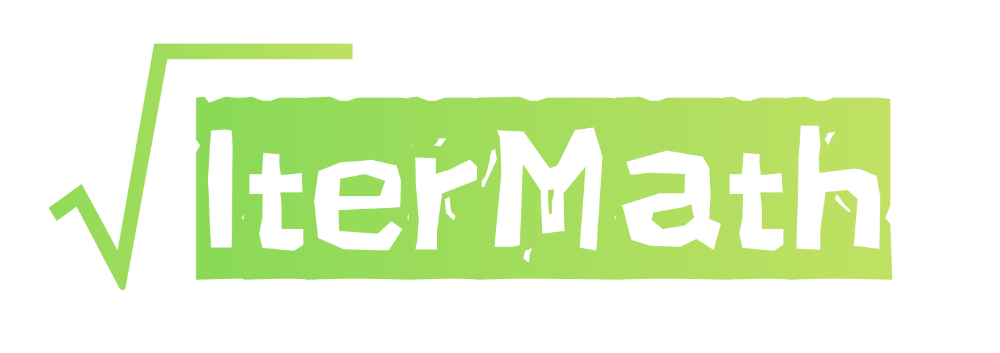
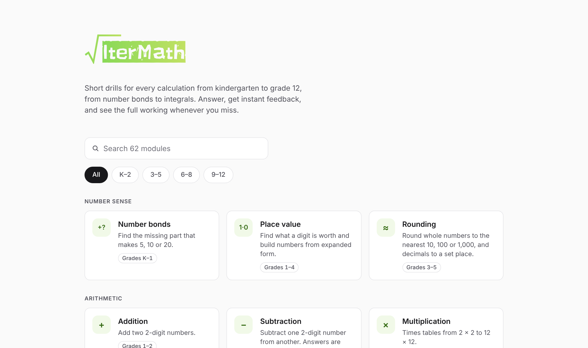
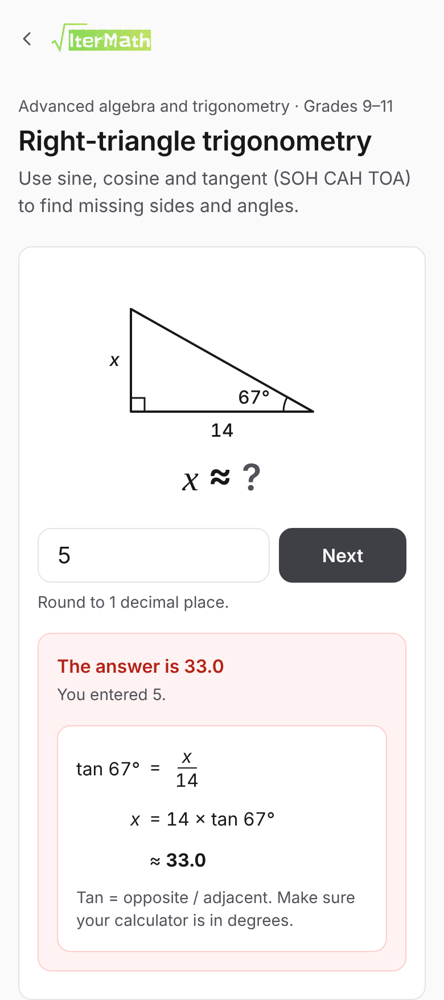
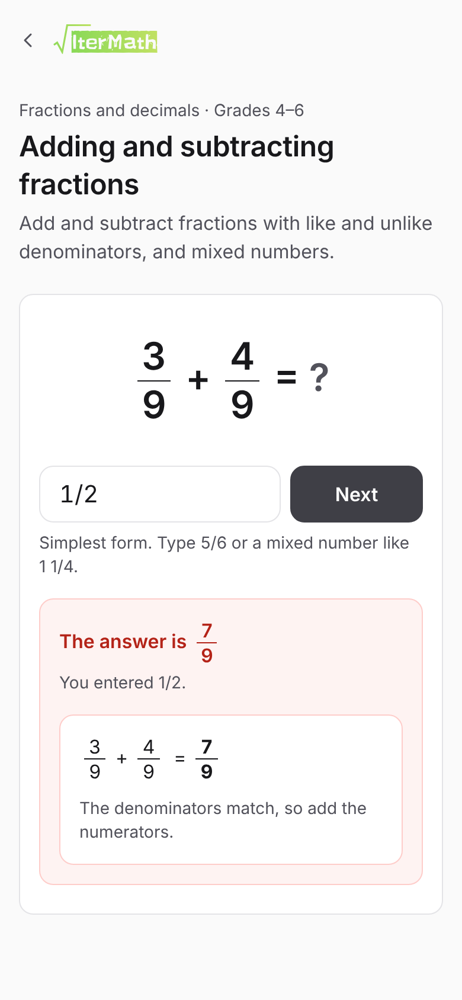

<p align="center">
  <a href="https://itermath.jomontolalu.com"></a>
</p>

<p align="center">
  Short math drills for every calculation from kindergarten to grade 12.<br>
  Answer, get instant feedback, and see the full working whenever you miss.
</p>

<p align="center">
  <a href="https://itermath.jomontolalu.com"><strong>Open IterMath</strong></a> ·
  <a href="#modules">Modules</a> ·
  <a href="#run-locally">Run locally</a> ·
  <a href="#adding-a-module">Add a module</a>
</p>

<p align="center">
  
  
  
  
</p>

<p align="center">
  
</p>

<p align="center">
  
  &nbsp;&nbsp;
  
</p>

## Features

- **62 modules, K–12.** From number bonds and times tables to factoring, logarithms, matrices, derivatives and integrals.
- **Endless questions.** Every module generates fresh questions, so there is nothing to memorise.
- **Worked solutions.** A wrong answer shows the right result and every step to get there.
- **Forgiving answer checking.** Fractions, mixed numbers, rounded decimals, multiple roots, inequalities, polynomials, radicals and complex numbers can all be typed the way students write them.
- **Grade filter and search.** Filter by K–2, 3–5, 6–8 or 9–12, and share a filter as a link like `/?grade=6-8`.
- **Fast and light.** Plain HTML, CSS and JavaScript with no framework, no build step and no third-party scripts. Math is drawn with HTML, CSS and inline SVG.

## Modules

Grade bands are a guide, based on when each topic usually appears in school. Every module lives at `/practice/<module>/`.

<details>
<summary><strong>Number sense</strong> · 3 modules · grades K–5</summary>

| Module | Grades | What it drills |
| --- | --- | --- |
| [Number bonds](practice/number-bonds/index.html) | K–1 | Find the missing part that makes 5, 10 or 20. |
| [Place value](practice/place-value/index.html) | 1–4 | Find what a digit is worth and build numbers from expanded form. |
| [Rounding](practice/rounding/index.html) | 3–5 | Round whole numbers to the nearest 10, 100 or 1,000, and decimals to a set place. |

</details>

<details>
<summary><strong>Arithmetic</strong> · 8 modules · grades 1–7</summary>

| Module | Grades | What it drills |
| --- | --- | --- |
| [Addition](practice/addition/index.html) | 1–2 | Add two 2-digit numbers. |
| [Subtraction](practice/subtraction/index.html) | 1–2 | Subtract one 2-digit number from another. Answers are never negative. |
| [Multiplication](practice/multiplication/index.html) | 3–4 | Times tables from 2 × 2 to 12 × 12. |
| [Division](practice/division/index.html) | 3–4 | Divide by 2 to 12. Every answer is a whole number. |
| [Division with remainders](practice/remainders/index.html) | 3–5 | Divide and give the quotient and remainder, like 7 R 3. |
| [Long multiplication](practice/long-multiplication/index.html) | 4–5 | Multiply 2- and 3-digit numbers by splitting into tens and ones. |
| [Long division](practice/long-division/index.html) | 4–6 | Divide 3- and 4-digit numbers by 1- and 2-digit divisors. Every answer is whole. |
| [Mixed operations](practice/arithmetics/index.html) | 5–7 | Expressions that combine all four operations. Answers can be negative. |

</details>

<details>
<summary><strong>Integers, powers and factors</strong> · 5 modules · grades 4–8</summary>

| Module | Grades | What it drills |
| --- | --- | --- |
| [Integers](practice/integers/index.html) | 6–7 | Add, subtract, multiply and divide negative numbers, and work with absolute value. |
| [Exponents](practice/exponents/index.html) | 5–8 | Evaluate powers, including negative bases, zero and negative exponents. |
| [Square and cube roots](practice/square-roots/index.html) | 6–8 | Find square roots of perfect squares and cube roots of perfect cubes. |
| [GCF and LCM](practice/gcf-lcm/index.html) | 4–6 | Find the greatest common factor and least common multiple of two numbers. |
| [Prime factorization](practice/prime-factorization/index.html) | 5–7 | Write a number as a product of primes. |

</details>

<details>
<summary><strong>Fractions and decimals</strong> · 7 modules · grades 3–7</summary>

| Module | Grades | What it drills |
| --- | --- | --- |
| [Equivalent fractions](practice/simplifying-fractions/index.html) | 3–5 | Simplify fractions and fill in the missing part of an equivalent fraction. |
| [Mixed numbers](practice/mixed-numbers/index.html) | 4–5 | Convert between improper fractions and mixed numbers. |
| [Adding and subtracting fractions](practice/fraction-addition/index.html) | 4–6 | Like and unlike denominators, and mixed numbers. Give answers in simplest form. |
| [Multiplying and dividing fractions](practice/fraction-multiplication/index.html) | 5–6 | Multiply and divide fractions and whole numbers. Give answers in simplest form. |
| [Adding and subtracting decimals](practice/decimal-addition/index.html) | 4–5 | Add and subtract decimals to the hundredths. |
| [Multiplying and dividing decimals](practice/decimal-multiplication/index.html) | 5–6 | Multiply and divide decimals by whole numbers and by other decimals. |
| [Fractions, decimals and percents](practice/fraction-decimal-percent/index.html) | 6–7 | Convert between fractions, decimals and percents. |

</details>

<details>
<summary><strong>Ratios and percents</strong> · 5 modules · grades 6–12</summary>

| Module | Grades | What it drills |
| --- | --- | --- |
| [Ratios and proportions](practice/ratios/index.html) | 6–7 | Simplify ratios, find equivalent ratios, share amounts and solve proportions. |
| [Unit rates and speed](practice/unit-rates/index.html) | 6–7 | Find the price of one, speed, distance and time. |
| [Percentages](practice/percentages/index.html) | 6–7 | Find a percent of a number, what percent one number is of another, and the whole. |
| [Percent change, discount and tax](practice/percent-change/index.html) | 7–8 | Percent increase and decrease, sale prices, sales tax and tips. |
| [Simple and compound interest](practice/interest/index.html) | 7–12 | Simple interest with I = Prt and compound interest, rounded to the cent. |

</details>

<details>
<summary><strong>Geometry and measurement</strong> · 7 modules · grades 3–10</summary>

| Module | Grades | What it drills |
| --- | --- | --- |
| [Unit conversion](practice/unit-conversion/index.html) | 3–6 | Convert metric and customary units of length, mass, capacity and time. |
| [Area and perimeter](practice/area-perimeter/index.html) | 3–7 | Rectangles, squares, triangles, parallelograms and trapezoids. |
| [Angles](practice/angles/index.html) | 4–8 | Complementary, supplementary, triangle and polygon angles. |
| [Volume and surface area](practice/volume/index.html) | 5–8 | Prisms, cubes, pyramids, cylinders, cones and spheres. |
| [Circles](practice/circles/index.html) | 7–8 | Circumference and area from the radius or diameter. |
| [Pythagorean theorem](practice/pythagorean-theorem/index.html) | 8–9 | Find a missing side of a right triangle with a² + b² = c². |
| [Coordinate geometry](practice/coordinate-geometry/index.html) | 6–10 | Distance, midpoint and slope between two points. |

</details>

<details>
<summary><strong>Statistics and probability</strong> · 4 modules · grades 6–12</summary>

| Module | Grades | What it drills |
| --- | --- | --- |
| [Mean, median, mode and range](practice/mean-median-mode/index.html) | 6–7 | Find the center and spread of a small data set. |
| [Probability](practice/probability/index.html) | 7–12 | Marbles, dice and coins, including two events. Give answers as fractions. |
| [Combinations](practice/combination/index.html) | 10–12 | Count the ways to choose items when order does not matter. Sets of 4 to 9. |
| [Permutations](practice/permutation/index.html) | 10–12 | Count the ways to arrange items when order matters. Sets of 3 to 8. |

</details>

<details>
<summary><strong>Algebra</strong> · 14 modules · grades 6–11</summary>

| Module | Grades | What it drills |
| --- | --- | --- |
| [Evaluating expressions](practice/evaluating-expressions/index.html) | 6–7 | Substitute values for variables and simplify. |
| [One-step equations](practice/one-step-equations/index.html) | 6–7 | Solve x + a = b, x − a = b, ax = b and x/a = b. |
| [Two-step equations](practice/two-step-equations/index.html) | 7–8 | Solve equations like 3x + 5 = 20 and x/4 − 2 = 3. |
| [Multi-step equations](practice/multi-step-equations/index.html) | 8–9 | Variables on both sides, brackets and like terms. |
| [Inequalities](practice/inequalities/index.html) | 7–9 | Solve linear inequalities, flipping the sign when dividing by a negative. |
| [Linear functions](practice/linear-functions/index.html) | 8–9 | Slope, intercepts and values of y = mx + b and Ax + By = C. |
| [Systems of equations](practice/systems-of-equations/index.html) | 8–9 | Solve two linear equations in x and y by elimination. |
| [Exponent rules](practice/exponent-rules/index.html) | 8–9 | Product, quotient and power rules, with zero and negative exponents. |
| [Scientific notation](practice/scientific-notation/index.html) | 8–9 | Convert to and from a × 10ⁿ, and multiply numbers in scientific notation. |
| [Polynomials](practice/polynomials/index.html) | 9–10 | Add, subtract and multiply polynomials. Type answers like 3x^2 − 2x + 5. |
| [Factoring quadratics](practice/factoring/index.html) | 9–10 | Factor trinomials, differences of squares and perfect squares. |
| [Quadratic equations](practice/quadratic-equations/index.html) | 9–10 | Solve by factoring, square roots and the quadratic formula. |
| [Simplifying radicals](practice/radicals/index.html) | 9–10 | Simplify square roots, multiply them and combine like radicals. |
| [Functions](practice/functions/index.html) | 9–11 | Evaluate functions, compose them and use inverses. |

</details>

<details>
<summary><strong>Advanced algebra and trigonometry</strong> · 6 modules · grades 9–12</summary>

| Module | Grades | What it drills |
| --- | --- | --- |
| [Logarithms](practice/logarithms/index.html) | 10–12 | Evaluate logs, use log rules and solve exponential equations. |
| [Sequences and series](practice/sequences/index.html) | 9–12 | Arithmetic and geometric sequences: next term, nth term and sums. |
| [Complex numbers](practice/complex-numbers/index.html) | 10–12 | Add, subtract, multiply and divide complex numbers, and powers of i. |
| [Right-triangle trigonometry](practice/trigonometry/index.html) | 9–11 | Use sine, cosine and tangent to find sides and angles. |
| [Unit circle and radians](practice/unit-circle/index.html) | 10–12 | Exact sine, cosine and tangent values, and converting degrees and radians. |
| [Matrices](practice/matrices/index.html) | 11–12 | 2 × 2 and 3 × 3 determinants and 2 × 2 matrix multiplication. |

</details>

<details>
<summary><strong>Calculus</strong> · 3 modules · grades 11–12</summary>

| Module | Grades | What it drills |
| --- | --- | --- |
| [Limits](practice/limits/index.html) | 11–12 | Direct substitution, removable discontinuities and limits at infinity. |
| [Derivatives](practice/derivatives/index.html) | 11–12 | Power rule for polynomials, slopes of tangents and the chain rule. |
| [Integrals](practice/integrals/index.html) | 11–12 | Antiderivatives of polynomials and definite integrals. |

</details>

## What students can type

The checker accepts any equivalent way of writing the same answer.

| Answer | Examples that count |
| --- | --- |
| Whole numbers and decimals | `42`, `-7`, `−7`, `3.5`, `.5`, `1,200` |
| Fractions and mixed numbers | `3/4`, `-2/3`, `1 1/2`. Fractions must be fully simplified unless the question says otherwise. |
| Rounded answers | Anything within half a unit of the stated place, so `12.57` and `12.566` both count for “2 decimal places”. |
| Answers with π | Either the calculator value of π or 3.14. |
| Several answers | `3, -5` for both roots of a quadratic, in any order. `(2, -1)` for an ordered pair. |
| Remainders | `7 R 3` |
| Ratios | `3:4` |
| Inequalities | `x > 3`, `x <= -2`, or the same thing written the other way round. |
| Polynomials | `3x^2 - 2x + 5`, in any order. Antiderivatives end with `+ C`. |
| Factored forms | `(x + 2)(x - 5)`, `(2x - 1)(x + 3)`, `(x - 3)^2` |
| Radicals and exact values | `6sqrt2`, `6√2`, `sqrt3/2`, `undefined` |
| Complex numbers | `3 + 2i`, `4 - i` |
| Prime factorizations | `2^3 × 3` or `2 x 2 x 2 x 3` |

If an answer has the right value but the wrong form, such as an unsimplified fraction, the page asks for a fix instead of marking it wrong.

## Project structure

```
.
├── index.html               Home page with search and grade filter
├── 404.html                 Not-found page
├── practice/
│   └── <module>/index.html  One page per module, each with its own question generator
├── assets/
│   ├── style.css            Design tokens, components and math layout
│   ├── practice.js          Practice engine, answer checker and math helpers
│   ├── itermath-logo.svg
│   ├── favicon.svg
│   ├── apple-touch-icon.png
│   └── og.png               Link preview image (1200 × 630)
├── sitemap.xml
├── robots.txt
└── docs/screenshots/        Screenshots for this README
```

## Run locally

Serve the folder with any static server:

```sh
python -m http.server 8000
```

Then open http://localhost:8000.

## Deploy

IterMath is a static site on Cloudflare Pages. Connect the repository with these settings:

| Setting | Value |
| --- | --- |
| Framework preset | None |
| Build command | *(empty)* |
| Build output directory | `/` |

Module pages are served at `/practice/<module>/`, with a trailing slash. Every link, canonical URL and sitemap entry uses that exact form, so pages load without a redirect.

## Adding a module

1. Copy an existing module folder inside `practice/` that takes the same kind of answer, for example `practice/fraction-addition/` for fraction answers, and rename it.
2. Update the title, description, canonical URL (`https://itermath.jomontolalu.com/practice/<module>/`) and `og:` tags in the `<head>`, and the group, grade, heading and lead in `.practice-header`.
3. Set the input's `inputmode` to suit the answer: `numeric` for whole numbers, `decimal` for non-negative decimals, `text` for anything with a minus sign, fraction bar or letters. Put any format help in `#hint`.
4. Replace the `generate` function. It must return:

   ```js
   {
     question: '12 + 34',                 // HTML; " = ?" is added for you
     answer: 46,                          // see the answer types below
     solution: M.column(12, '+', 34, 46)  // HTML shown on a wrong answer
   }
   ```

   Answer types:

   | `answer` | Marked as |
   | --- | --- |
   | `46`, `2.5` | Exact number |
   | `M.Q(3, 4)` | Exact fraction. Equal decimals and mixed numbers count, and fractions must be simplified. |
   | `[3, -5]` | Several values separated by commas, in any order. Add `ordered: true` for pairs like `(x, y)`. |
   | `'x>3'` | Text, compared after normalising spaces, signs and `sqrt`. Add `accept: [...]` for other spellings. |

   Optional fields: `prompt` (an instruction above the question), `ask` (replaces ` = ?`, or `false` for none), `places` (round to this many decimal places), `form` (`'fraction'`, `'mixed'`, `'improper'` or `'decimal'`), `check` (a custom marking function), `display` (how to show the right answer), `hint` and `placeholder`.

   Ready-made checkers: `M.polyCheck(coeffs)`, `M.factorCheck(coeffs)`, `M.radicalCheck(k, r)`, `M.complexCheck(re, im)` and `M.piCheck(k, places)`.

   Rendering helpers on `M`: `num`, `operand`, `sym`, `frac`, `q` (a fraction or mixed number), `pow`, `sqrt`, `abs`, `terms`, `poly`, `matrix`, `integral`, `lim`, `triangle`, `column`, `steps` and `note`. Number helpers: `rand`, `randNZ`, `pick`, `shuffle`, `fact`, `gcd`, `lcm`, `isPrime`, `primeFactors`, `round` and the fraction maths `Q`, `qadd`, `qsub`, `qmul`, `qdiv`.

5. Call `M.practice({ input: 'number', generate: ... })`. Leave `input` out only for whole-number drills, which then accept digits only (set `allowNegative: true` to allow a minus sign).
6. Add a card for it to `index.html` in the right group, linking to `practice/<module>/`, with a `data-grades="low-high"` range (K is 0) so the grade filter finds it.
7. Add `https://itermath.jomontolalu.com/practice/<module>/` to `sitemap.xml`.

## Author

Built by [Jonathan Montolalu](https://jomontolalu.com).
